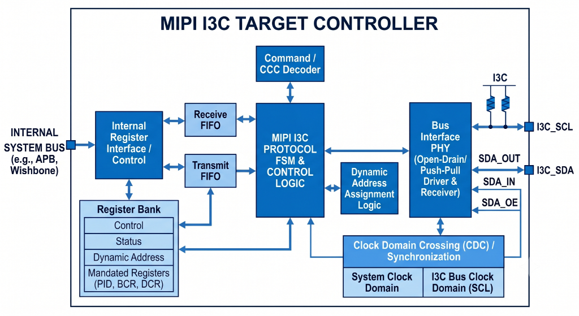
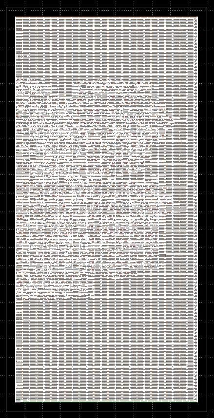
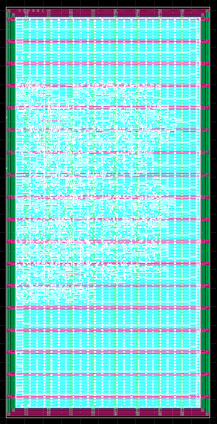
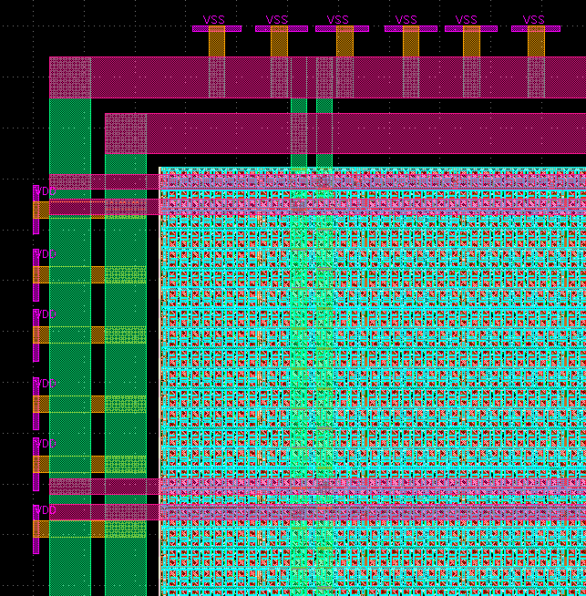
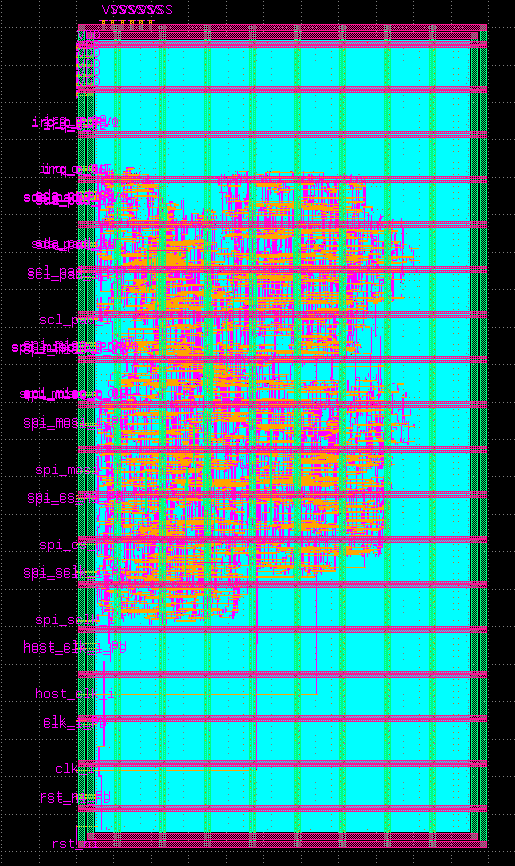

# OpenTarget-I3C: A Plug-and-Play MIPI I3C Target Controller

**IEEE SSCS Chipathon 2026 - Track A: Foundational Building Blocks**

**Team Technocrats:** Tejas Patel (Free-95), Krishang Talsania (talsania)

**Project Proposal:** [Proposal Slides](https://docs.google.com/presentation/d/1kvmwrsm0WWyItiA36Kk5RK9bUFDRB8TwC0aXO_wy3RY/edit?usp=sharing)

**Schematic Review:** [Schematic Review Slides](https://docs.google.com/presentation/d/1p5AOORYqGNfi6nefUZTjHjBq82RTqXWiQkIK3BwQR2A/edit?usp=sharing)

**Layout Review   :** [Layout Review Slides](https://docs.google.com/presentation/d/1qFgVn4FwrAukM8L5o4HKxZpqRlonfdM_cFp89nPWMHo/edit?usp=sharing)

---

## 1. Project Description & Overview

### Introduction

Legacy bus interfaces such as I2C and SPI face scaling, wiring complexity, and power bottlenecks in modern system-on-chips (SoCs) handling high-density sensor aggregation, edge AI telemetry, and biomedical wearables. The **MIPI I3C (Improved Inter-Integrated Circuit)** standard bridges this gap by offering a high-speed, low-power, two-wire utility and control bus that unifies sensor management while maintaining backward compatibility with legacy I2C devices.

**OpenTarget-I3C** is a lightweight, silicon-proven MIPI I3C Target Controller designed during and as a part of IEEE SSCS Chipathon 2026 Track A (*Foundational Building Blocks*). The IP core provides a standardized, zero-wait state AMBA APB3 interface to host microcontrollers while complying with the MIPI I3C Basic specification.

### Key Features & Specifications

* **Standard Data Rate (SDR) Compliance:** Operates up to 12.5 MHz SCL clock speed.

* **Advanced I3C Capabilities:** Native support for Dynamic Address Assignment (DAA), Common Command Codes (CCCs), In-Band Interrupts (IBIs) with Mandatory Data Bytes (MDB), Pending Read Notifications (PRN), and Hot-Join (HJ) requests.

* **Dynamic Address Assignment (ENTDAA):** Full 64-bit `{PID, BCR, DCR}` open-drain arbitration, odd-parity checked address assignment, multi-target arbitration loss/retry, and `RSTDAA` support. A target that already owns an address stays silent through DAA rounds. Hot-Join followed by ENTDAA is the supported bring-up path for late-attaching targets.

* **Host Interrupt Controller:** 12 sticky event sources (RX/TX FIFO events, IBI done/lost, DAA done, RSTDAA, ENEC/DISEC, STOP, HDR entry, unsupported CCC, GET-CCC retry exhausted) with a write-1-to-clear `INT_STATUS` register, a per-bit `INT_ENABLE` mask and a single level-sensitive `irq_o` pin.

* **Zero-Wait State Host Interface:** AMBA APB3 peripheral interface enables fast register configuration and burst FIFO read/write operations.

* **Glitch-free Physical Front-End:** 3-stage digital consensus glitch filters (<50ns spike rejection) ensuring safe I2C/I3C coexistence.

* **Silicon Implementation Target:** Hardened on **GlobalFoundries 180nm (`gf180mcuD`)** process node meeting Configuration BV footprint constraints for the Chipathon.

---

## 2. Architecture & Working of I3C Target Controller

OpenTarget-I3C utilizes a modular hierarchical architecture managed by a top-level wrapper, ensuring clean clock domain crossing (CDC) and robust bus handling. Below given is the conceptual architecture diagram of an I3C Target Controller, followed by a modular block diagram of the implemented architecture.

<div align="center">
  
  <br><br>

```text
                               MIPI I3C BUS
                               (I3C_SCL, I3C_SDA - 2 Pins)
                                │
                                ▼
┌─────────────────────────────────────────────────────────────────────────────┐
│                              opentarget_i3c_top                             │
│                                                                             │
│       ┌──────────────────────┐            ┌─────────────────────────┐       │
│       │   i3c_phy_frontend   │◄──────────►│     i3c_protocol_fsm    │       │
│       │   (OD/PP Drivers &   │            │  (Core Protocol Engine  │       │
│       │    Glitch Filters)   │            │   & Address Matching)   │       │
│       └──────────────────────┘            └──────────┬──────────────┘       │
│                    ▲                                 │                      │
│                    │                                 ▼                      │
│       ┌────────────┴─────────┐            ┌─────────────────────────┐       │
│       │      i3c_bus_det     │            │     i3c_ccc_decoder     │       │
│       │ (Async START/STOP &  │            │  (Broadcast & Direct    │       │
│       │  Bus Timing Detect)  │            │    CCC Command Parser)  │       │
│       └──────────────────────┘            └──────────┬──────────────┘       │
│                                                      │                      │
│                                           ┌──────────┴──────────────┐       │
│                                           │     i3c_ibi_hj_ctrl     │       │
│                                           │ (In-Band Interrupt &    │       │
│                                           │    Hot-Join Manager)    │       │
│                                           └──────────┬──────────────┘       │
│                                                      │                      │
│       ┌──────────────────────┐            ┌──────────┴──────────────┐       │
│       │     i3c_fifo_cdc     │◄──────────►│      i3c_apb_regs       │       │
│       │  (Dual-Clock Async   │            │ (APB3 Register Bank &   │       │
│       │     TX/RX FIFOs)     │            │ PID/BCR/DCR Descriptors │       │
│       └──────────────────────┘            └──────────┬──────────────┘       │
└──────────────────────────────────────────────────────┼──────────────────────┘
                                │
                                ▼
                                 Host SoC APB3 Bus
                                (clk_i, rst_ni, paddr, etc.)

```
</div>

### Module Breakdown & Functional Descriptions

1. **`i3c_phy_frontend`:** Interfaces directly with bidirectional I/O pads (`gf180mcu_fd_io`), dynamically switching between Open-Drain (OD) and Push-Pull (PP) signaling modes while managing internal turn-around timing ($t_{SCO}$).


2. **`i3c_bus_det`:** Asynchronous bus condition detector tracking START ($S$), Repeated START ($Sr$), and STOP ($P$) conditions, alongside Bus Free, Available, and Idle timing states.


3. **`i3c_protocol_fsm`:** The core state machine handling 7-bit/broadcast address matching (including 7'h7E), parity checks, T-bit handshaking, and data phase routing. It also runs the ENTDAA loop (64-bit ID arbitration, address + parity reception, address commit) and raises the single-cycle event strobes (TX underrun, HDR entry, DAA done) used by the interrupt logic.


4. **`i3c_ccc_decoder`:** Parses mandatory broadcast CCCs (`ENEC`, `DISEC`, `RSTDAA`, `ENTDAA`, `SETMWL`, etc.) and direct CCCs (`GETPID`, `GETBCR`, `GETDCR`, `GETSTATUS`, `GETMXDS`).


5. **`i3c_ibi_hj_ctrl`:** Manages target-initiated In-Band Interrupts (IBIs), formulating Mandatory Data Byte (MDB) payloads, Pending Read Notifications (PRN), and Hot-Join requests.


6. **`i3c_apb_regs`:** AMBA APB3 slave interface housing configuration registers, status flags, and mandated descriptors (`PID`, `BCR`, `DCR`), plus the interrupt status/enable registers and the `irq_o` output.


7. **`i3c_fifo_cdc`:** Dual-clock asynchronous FIFOs bridging the external 12.5 MHz I3C bus domain with the internal host SoC clock domain.

### Host Interrupts (`irq_o`)

Each event source below produces a single-cycle pulse in the `clk_i` domain. A pulse sets the matching bit in `INT_STATUS`; the bit stays set until the host clears it by writing `1` to it (write-1-to-clear). If an event arrives in the same cycle as a clear of that bit, the event wins and is not lost. `irq_o` is a registered **level** output equal to `|(INT_STATUS & INT_ENABLE)`.

| Address | Register | Access | Description |
|---|---|---|---|
| `0x30` | `INT_STATUS` | R/W1C | Sticky event flags (bit map below). Unimplemented upper bits read as 0. |
| `0x34` | `INT_ENABLE` | R/W | Per-bit mask onto `irq_o`. Resets to `0` (all masked). |

| Bit | Event | Source |
|---|---|---|
| 0 | RX byte | Private-write byte pushed to the RX FIFO |
| 1 | RX overflow | Byte arrived with the RX FIFO full (byte dropped) |
| 2 | TX underrun | Private read with nothing in the TX FIFO to send |
| 3 | IBI done | IBI fully sent and ACKed |
| 4 | IBI/HJ lost | IBI or Hot-Join NACKed or arbitration lost |
| 5 | DAA done | ENTDAA assigned a dynamic address |
| 6 | RSTDAA | Dynamic address cleared by `RSTDAA` |
| 7 | ENEC/DISEC | Event enable/disable CCC applied |
| 8 | STOP | STOP condition (transfer boundary) |
| 9 | HDR entry | `7E/R` outside ENTDAA; target goes silent |
| 10 | Unsupported CCC | CCC opcode the decoder does not implement |
| 11 | GET retry exhausted | Direct GET CCC answered while data was still pending |

>[!IMPORTANT]
>`irq_o` previously followed `core_status[0]` directly. It is now gated by `INT_ENABLE`, which resets to `0`. Host software must write `INT_ENABLE` (`0x34`) to unmask the events it cares about, and write `INT_STATUS` (`0x30`) to acknowledge them. In the SPI-wrapped macro these registers are reachable at the same addresses.

>[!NOTE]
>Due to the physical pin/pad constraints for the tapeout in Chipathon, the designed I3C Controller though being a serial-communication protocol - is wrapped with an SPI bridge at the APB3 interface for reducing the pin count. This I3C IP has two interfaces - one to physical IO pads (serial) and other to the host SoC (parallel), as the IP will be taped out alone without any host SoC the parallel APB3 interface with numerous pins has to be connected to a Serial Protocol bridge. This modification is just for the tapeout, it is not required while integrating into an SoC.

---

## 3. RTL Implementation and Functional Verification

The RTL source files are written in either **SystemVerilog (`.sv`)** or **Verilog (`.v`)** and located inside the `src/` directory. Each source file is named according to the RTL module described in it.

Functional Verification of the complete design is performed using the Python-based `cocotb` framework. It is divided into 3 + 1 stages (additional stage is for the SPI-to-APB bridge testbench) which are as follows:

- **Independent Module Testbenches:** `i3c_apb_regs ` and `i3c_phy_frontend` are tested individually as their operation doesn't always depend on the inputs from other modules.
  1. **`test_apb_regs.py`:** Validates reset behavior, read/write register maps, read-only register protection, error injection (`pslverr_o`), and zero-wait state `pready_o` handshaking. Also covers the interrupt registers: reset defaults, sticky set / write-1-to-clear, `INT_ENABLE` masking and level behaviour of `irq_o`, event-wins-over-clear, and the address map around `0x30`/`0x34`.
  2. **`test_phy_frontend.py`:** Validates reset behavior, glitch-free transitions, SCL/SDA filters' independence, and clean output drive logic.
 
- **MAC Layer Testbench (`test_mac_cluster.py`):** `i3c_bus_det`, `i3c_protocol_fsm`, `i3c_ccc_decoder` and `i3c_ibi_hj_ctrl` together constitute the Media Access Control Layer of this IP. This testbench validates bus detector timing, broadcast/direct CCC parsing, single-retry protocol models, IBI open-drain arbitration, Hot-Join requests, HDR-ignore mode, and private read/write transfers by evaluating these modules altogether. It also covers ENTDAA: single-target assignment, ID arbitration loss followed by a win in the next round, bad-parity rejection, already-assigned targets staying silent, `RSTDAA` followed by re-assignment, and `7E/R` outside ENTDAA still being treated as HDR entry.

- **Top-Level Testbench (`test_opentarget_top.py`):** Validates the complete Bus Functional Model of this IP and edge cases in every operation end-to-end. This includes ENTDAA/RSTDAA through the real PHY, the Hot-Join to ENTDAA bring-up sequence, and one test per `INT_STATUS` event bit that drives real bus/host stimulus and checks the exact set of bits raised (so a dropped or swapped wire in the event vector fails a test), plus `irq_o` masking, level and write-1-to-clear behaviour.

- **SPI Wrapper-Level Testbenches:**
  1. **`test_spi_apb_bridge.py`:** Validates the reset behavior, single and multiple writes, error propagation, and SPI-to-APB and APB-to-SPI communication.
  2. **`test_spi_opentarget_top.py`:** Validates the complete SPI-wrapped I3C Target Controller for most possible edge cases, including the `INT_STATUS`/`INT_ENABLE` registers over SPI and `irq_o` following an IBI completion.
 
All these testbenches are present in the `cocotb/` directory with a `Makefile` to simulate them.
To compile and check syntax, use the below Icarus Verilog command from the root directory:

```bash
iverilog -g2012 -o opentarget_i3c src/*.sv src/*.v
```

To run the `cocotb` testbenches, navigate to the `cocotb/` directory and type the `make` command:
```bash
cd cocotb/
make                   # Run all testbenches
make <testbench-name>  # Run a specific testbench
```

>[!NOTE]
>Usage of `make` command for functional verification is provided in the `Makefile` of `cocotb/` directory.

---

## 4. Formal Verification using SymbiYosys

Formal property checking is structured using SymbiYosys (`.sby`) configurations inside the `formal/` directory for critical control logic:

* `formal/fifo_cdc.sby` - Verifies CDC FIFO pointer safety and overflow/underflow protection.

* `formal/ibi_hj_ctrl.sby` - Formally proves IBI arbitration and Hot-Join state transitions.

* `formal/protocol_fsm.sby` - Validates deadlock freedom and protocol compliance of the FSM.


Execute a formal proof job using below commands (e.g., for the protocol FSM):

```bash
cd formal/
sby -f protocol_fsm.sby
```

>[!NOTE]
>Usage of formal proof execution command (`sby`) is provided in the `commands.txt` file in root directory.

---

## 5. Logic Synthesis, Physical Design & Signoff using Librelane

The physical implementation follows an automated RTL-to-GDSII flow powered by **LibreLane** targeting the **GlobalFoundries 180nm (`gf180mcuD`)** open-source PDK.

### Configuration & Constraints

* **Technology Node:** `gf180` (GlobalFoundries 180nm node with 5 Metal Layers)

* **Operating Voltage:** 5.0V Nominal (`nom_tt_025C_5v00`)

* **Design Configurations:** Managed via `librelane/config.yaml` for mapping the standard cell library, defining clocks, setting up floorplan and power delivery network, and passing constraints for PnR and Signoff.

* **Timing Constraints:** Clock definitions, IO delays and parasitic constraints are provided in `librelane/spi_opentarget_i3c_top.sdc`

### Running the Physical Design Flow

**IIC-OSIC-TOOLS** Docker container is the platform which we have used to access the open-source EDA toolchain. The `Makefile` in the root directory contains the commands to execute the Physical Implementation. To execute the complete flow at once, use the below command:

```bash
make librelane PDK_ROOT=/foss/pdks 2>&1 | tee build_signoff.log
```

Though the execution of complete flow includes DRC, LVS and Antenna Rule checks, the individual checks can be performed using the commands present in `commands.txt` file in root directory.

---

## 6. Results and Reports of the Flow


The above snapshot shows the successful execution of complete flow without any violations. All finalized signoff reports and metrics are archived in the `signoff/` directory.

The integration-ready Layout Database file for Chipathon is present in `integration/` directory along with the final powered netlist required for LVS check. The quality metrics - utilization, area, and cell count statistics are logged in `metrics.csv` and `metrics.json` files in `final/` directory along with `build_signoff.log` (log of complete librelane run).

### Summary of Key Metrics (nominal typical corner, `nom_tt_025C_5v00`)

| Metric | Result |
|---|---|
| Die / core area | 610,500 µm² / 526,734 µm² (550 × 1110 µm die) |
| Standard-cell instances (excl. fill, tap, endcap) | 7,142 (125,552 µm²) |
| Core utilization | 23.8 % |
| Sequential cells (flip-flops) | 767 |
| Setup worst slack (all corners) / hold worst slack (all corners) | +3.23 ns / +0.10 ns |
| Setup / hold violations | 0 / 0 |
| Max slew, max cap, max fanout violations | 0 / 0 / 0 |
| Total power | 55.8 mW |
| Worst IR drop | 0.33 mV |
| Route DRC errors / Magic DRC errors | 0 / 0 |
| Antenna violating nets / pins | 0 / 0 |
| LVS | Circuits match uniquely (3,220 devices, 3,225 nets) |

### Glimpses of the final layout GDS
1. **Placement of standard cells**
   
    

2. **Power Delivery Network**

    

3. **Connectivity of VDD and VSS pins with power ring**

    

4. **Final GDS layout** (`PR Boundry` disabled for better visibility)

    